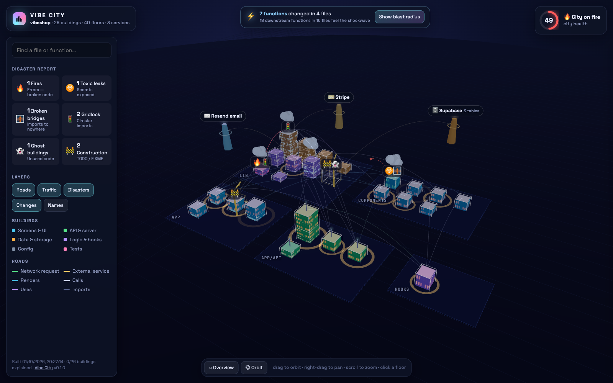
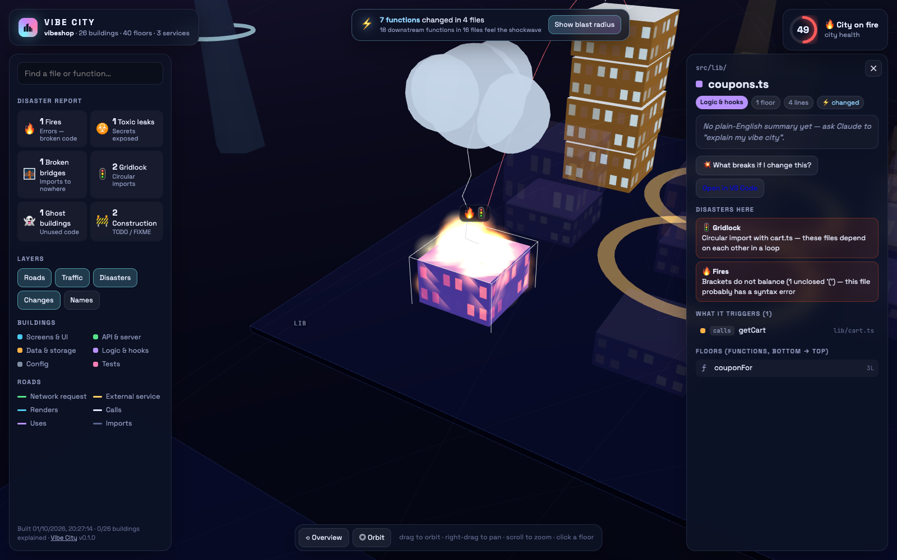

# 🏙️ Vibe City

**See your codebase as a living 3D city.** A Claude Code skill for people who build fast and want to know what they actually built.



You vibe-coded an app. It works (mostly). But what talks to what? Where does the data come from? And what else did that last change break?

Vibe City answers those questions with a city you can fly around:

| In your code | In the city |
|---|---|
| A file | 🏢 a building, colored by what it does (UI, API, data, logic) |
| A function / component | a **floor** in that building; click it |
| Calls, renders, `fetch('/api/…')` | ✨ glowing **roads** with traffic flowing along them |
| Stripe, Supabase, OpenAI, Resend… | 🗼 **towers on the horizon** |
| Folders | districts |

## Disasters 🔥

Problems don't hide in a list. They happen *to your city*:

| Disaster | Meaning |
|---|---|
| 🔥 **Fire** | Errors: syntax errors, type errors, failing tests (`--check`, `--check-cmd "npm test"`) |
| ☣️ **Toxic leak** | Hard-coded API keys, or server secrets read in browser code |
| 🌉 **Broken bridge** | An import pointing at a file that doesn't exist |
| 🚦 **Gridlock** | Circular imports |
| 👻 **Ghost building** | A file nothing uses (floating, translucent) |
| 🚧 **Construction** | `TODO` / `FIXME` (with a working crane) |

Every city gets a **health score** and a weather report: ☀️ Sunny skies → 🌪️ Disaster zone.

## ⚡ Storms and shockwaves: what did my change affect?

Uncommitted changes get a **storm cloud with lightning**. Everything that depends on them, directly or several hops away, gets an **orange shockwave**. Before you ship, you can see exactly which screens and API routes to re-test.

Click any floor and press **💥 What breaks if I change this?** to get the same answer *before* you touch it.

## ▶ Trace the flow

Select a component and hit **▶ Trace**. A pulse runs from the button click through your hook, across the network to the API route, into the database tower, step by step. Each step is listed in plain English.



## 🧠 Claude explains every building

The scanner works out the structure (no AI, instant). Claude adds the meaning: a one-line, plain-English summary of every file and function, plus any real risks it notices while reading. Summaries are cached per file and marked stale when the code changes.

## Try it in 30 seconds

No install, and no project of your own needed. The repo includes a small, deliberately broken demo store:

```bash
git clone https://github.com/themanasarora/Vibe_City && cd Vibe_City
python3 skills/vibe-city/scripts/vibecity.py build examples/vibeshop --open
```

You'll get a city on fire (health 49). Click the burning building, trace `AddToCartButton`, then ask what breaks if you change `formatPrice`. When you're ready, point it at your own project.

## Install

**As a Claude Code plugin** (adds the skill and an auto-refresh hook):

```
/plugin marketplace add themanasarora/Vibe_City
/plugin install vibe-city@vibe-city
```

**Just the skill:** copy `skills/vibe-city/` into `~/.claude/skills/` (all projects) or `.claude/skills/` (one project).

Then ask Claude:

> show me my vibe city
>
> what did my changes affect?
>
> what breaks if I change formatPrice?
>
> why is my app broken? (it runs your tests and sets the broken parts on fire)

## Use it without Claude

It's plain Python 3. No `npm install`, no dependencies.

```bash
python3 skills/vibe-city/scripts/vibecity.py build path/to/project --open
python3 skills/vibe-city/scripts/vibecity.py serve path/to/project   # live city, rebuilds on every save
```

| Flag | |
|---|---|
| `--check` | run the project's TypeScript checker; errors become fires |
| `--check-cmd "npm test"` | run any command; `file:line` errors become fires |
| `--errors crash.log` | map a saved stack trace onto the city |
| `--base main` | blast radius against a branch instead of uncommitted changes |
| `--json` | machine-readable health / impact / incidents |

Deep links: `city.html#select=src/lib/cart.ts#addToCart`, `#trace=…`, `#breaks=…`, `#impact`.

**Live mode** is the fun one. Keep `serve` running next to Claude Code and watch new buildings rise, storms roll in and fires start as the agent edits your code.

## What it understands

- **JS / TS / JSX / TSX**: React, Next.js (app router + pages API routes, path aliases), Express / Hono / Fastify routes, Vue & Svelte script blocks
- **Python**: modules, FastAPI / Flask routes, `requests` / `httpx` calls
- Front-end `fetch` / axios / SWR calls are matched to the API route that handles them
- 40+ services detected (Stripe, Supabase, Firebase, Prisma, Postgres, Mongo, Redis, OpenAI, Claude, Gemini, Resend, Clerk, Auth.js, AWS, …), including which database tables you touch

The analysis is static and heuristic. It won't see calls made through strings or dependency injection, but for typical vibe-coded apps it gets the important roads right.

## Files

```
.claude-plugin/        plugin + marketplace manifests
hooks/hooks.json       Stop hook: refreshes an existing city after each Claude turn
skills/vibe-city/
  SKILL.md             instructions Claude follows
  scripts/vibecity.py  CLI (build / serve / pending / notes / hook)
  scripts/vc_scan.py   per-file scanner (JS masking tokenizer + Python ast)
  scripts/vc_analyze.py  linking, disasters, blast radius, health
  assets/viewer.html   the three.js city
```

Output lives in `<project>/.vibecity/`. Commit `notes.json` (Claude's explanations); `city.html` and `graph.json` are gitignored automatically.

## Contributing

**Got an idea?** [Open a 💡 Idea issue](https://github.com/themanasarora/Vibe_City/issues/new?template=idea.yml). What should become a disaster next? Some on the wish list: 🌊 floods for slow endpoints, 🧟 zombie dependencies, 🚨 missing auth on API routes.

**Something wrong?** [Report it](https://github.com/themanasarora/Vibe_City/issues/new?template=bug.yml) with a small code sample.

PRs welcome too, especially for more languages (Go, Ruby, PHP) and frameworks. See [CONTRIBUTING.md](CONTRIBUTING.md).

MIT licensed.
